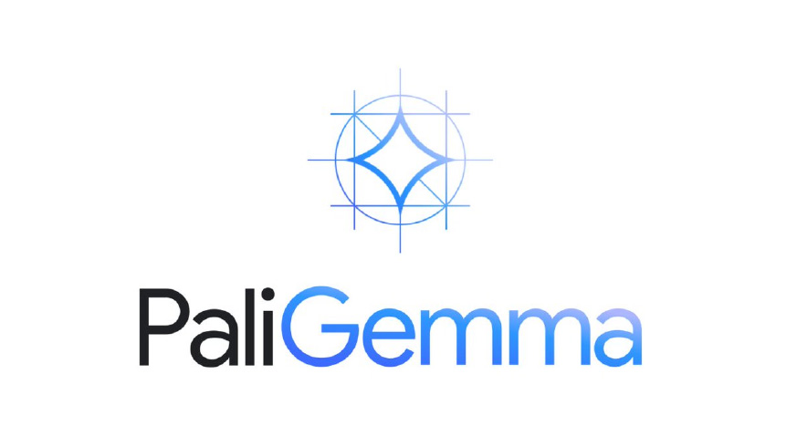
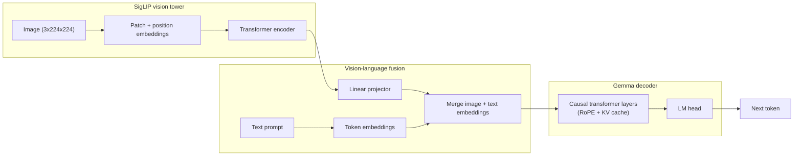

<p align="center">
    <a href="docs/imgs/PaLiGemma-Model-Logo.jpg">
        
    </a>
</p>

# PaliGemma from scratch in PyTorch

[](https://github.com/eljandoubi/PaliGemma/actions/workflows/ci.yml)
[](LICENSE)

PaliGemma ([Beyer et al., 2024](https://arxiv.org/abs/2407.07726)) pairs a SigLIP vision encoder with a Gemma decoder-only language model to answer questions about images and describe them. This repository re-implements the architecture and the autoregressive generation loop in plain PyTorch, and downloads only the pretrained weights from the Hugging Face Hub.

It is built for learning and experimentation, not for production serving.

## How to run

### Requirements

- macOS or Linux with [uv](https://docs.astral.sh/uv/getting-started/installation/) on `PATH`. uv downloads a matching Python 3.12 interpreter, as pinned in [.python-version](.python-version).
- A [Hugging Face](https://huggingface.co/) account with access to the [`google/paligemma`](https://huggingface.co/google) checkpoints, and a token if you have not run `huggingface-cli login` locally. Set it in a `.env` file as `HF_TOKEN=...`.
- Disk space and RAM for a PaliGemma checkpoint (the default 3B model is a few GB).

### Quickstart

Clone the repository:

```bash
git clone https://github.com/eljandoubi/PaliGemma.git && cd PaliGemma
```

Build the environment. This runs `uv sync`, which creates a `.venv` and installs the runtime and dev dependencies from [uv.lock](uv.lock):

```bash
make build
```

Run inference on the default test case, `samples/EiffelTower.jpg` with the prompt `"this tower is "`:

<p align="center">
    
</p>

```bash
make run
```

Try your own prompt and image by overriding the variables declared in the [Makefile](Makefile):

```bash
make run PROMPT="this building is " IMAGE_FILE_PATH="samples/EiffelTower.jpg"
```

Remove the `.venv` and the downloaded weights:

```bash
make clean
```

### CLI reference

`inference.py` is a [`fire`](https://github.com/google/python-fire) command line. Every flag below maps to a `make run VAR=value` override.

| Flag | Default | Description |
| --- | --- | --- |
| `--model-id` | `google/paligemma-3b-pt-224` | Hugging Face Hub id of the checkpoint to download. |
| `--model-path` | `~/paligemma-weights` | Local directory used to cache the downloaded weights. |
| `--prompt` | `this tower is ` | Text prefix given to the model. |
| `--image-file-path` | `samples/EiffelTower.jpg` | Path to the input image. |
| `--max-tokens-to-generate` | `100` | Maximum number of new tokens to decode. |
| `--temperature` | `0.8` | Softmax temperature, used only when `--do-sample=True`. |
| `--top-p` | `0.9` | Nucleus sampling threshold, used only when `--do-sample=True`. |
| `--do-sample` | `False` | `True` for top-p sampling, `False` for greedy decoding. |
| `--only-cpu` | `False` | Force CPU execution even if CUDA or MPS is available. |

## Design choices



The image is split into patches, embedded, and encoded by the SigLIP tower. Patch features are linearly projected into the Gemma embedding space and merged with the token embeddings of the prompt. The causal decoder then generates one token at a time from a growing KV cache.

- The SigLIP vision transformer, the Gemma decoder, rotary position embeddings and the image and text fusion are written directly on `torch.nn`.
- Generation reuses past key and value states, so each new token needs one forward pass over one position.
- Decoding is greedy by default. A single flag switches to top-p sampling with temperature.
- The weights come from a `safetensors` checkpoint and its tokenizer, downloaded from the Hugging Face Hub and loaded into the model.
- The device is CUDA when available, then Apple Silicon `mps`, then CPU.

| Module | File | Responsibility |
| --- | --- | --- |
| `SiglipVisionModel` | [src/models/siglip.py](src/models/siglip.py) | Encodes the image into patch embeddings. |
| `GemmaForCausalLM` | [src/models/gemma.py](src/models/gemma.py) | Decoder-only language model with RoPE and KV cache. |
| `PaliGemmaForConditionalGeneration` | [src/models/paligemma.py](src/models/paligemma.py) | Projects image features and fuses them with text. |
| `PaliGemmaProcessor` | [src/processors/paligemma_processor.py](src/processors/paligemma_processor.py) | Image resizing and normalization, prompt tokenization. |
| `KVCache` | [src/utils/kv_cache.py](src/utils/kv_cache.py) | Stores past keys and values for decoding. |

```text
PaliGemma/
├── inference.py                       # CLI entry point
├── check.sh                           # Verifies HF_TOKEN is set
├── Makefile                           # build / run / lint / format / test / clean
├── pyproject.toml                     # Project metadata, dependencies, Ruff and pytest config
├── uv.lock                            # Locked dependency versions (uv)
├── .python-version                    # Pinned interpreter version (3.12)
├── src/
│   ├── configs/
│   │   └── base_config.py             # Shared `BaseConfig.from_dict` helper
│   ├── models/
│   │   ├── siglip.py                  # SigLIP vision encoder
│   │   ├── gemma.py                   # Gemma decoder-only language model
│   │   └── paligemma.py               # Vision-language fusion model
│   ├── processors/
│   │   └── paligemma_processor.py     # Image and text preprocessing
│   └── utils/
│       ├── kv_cache.py                # Autoregressive KV cache
│       ├── model_loader.py            # HF Hub weight download and loading
│       └── tools.py                   # RoPE helpers
├── tests/                             # pytest unit tests (mirrors `src/`)
├── samples/                           # Sample input image(s)
└── docs/imgs/                         # README assets
```

## Status and limits

- This is an independent, educational re-implementation. It is not affiliated with or endorsed by Google.
- No sample output is shown here yet.
- The tests in [tests/](tests/) exercise every module under `src/` (configs, KV cache, RoPE helpers, the SigLIP, Gemma and PaliGemma models, and the processor) with tiny random configs. They run in a couple of seconds on CPU and download no checkpoint. The sampling and device-handling helpers of `inference.py` are covered too.

## Development

Dependencies are managed with [uv](https://docs.astral.sh/uv/), code is linted and formatted with [Ruff](https://docs.astral.sh/ruff/), and tests run with [pytest](https://docs.pytest.org/). All three are wired into the `Makefile` and into [CI](.github/workflows/ci.yml):

```bash
make lint    # ruff check + ruff format --check
make format  # ruff check --fix + ruff format
make test    # pytest
```

Every push and pull request runs `ruff check`, `ruff format --check` and `pytest` in GitHub Actions, each against the dependency versions pinned in [uv.lock](uv.lock).

## License

Distributed under the terms of the [Apache License 2.0](LICENSE).

## Acknowledgements

- Google DeepMind for the [PaliGemma](https://arxiv.org/abs/2407.07726), [Gemma](https://arxiv.org/abs/2403.08295) and [SigLIP](https://arxiv.org/abs/2303.15343) papers.
- [Hugging Face](https://huggingface.co/) for hosting the pretrained checkpoints and for the `transformers` and `safetensors` libraries used to load them.
