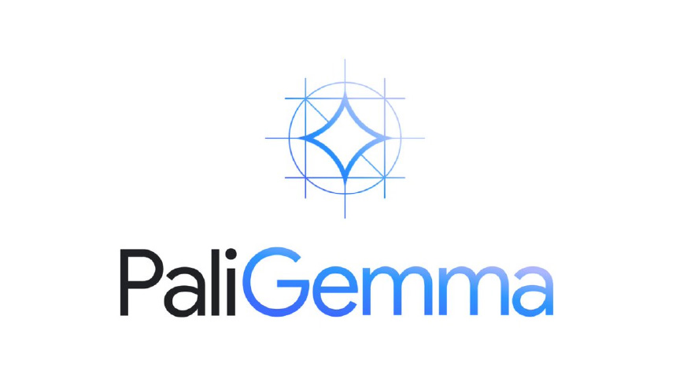
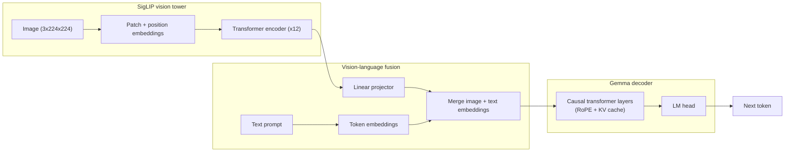

<p align="center">
    <a href="docs/imgs/PaLiGemma-Model-Logo.jpg">
        
    </a>
</p>

<p align="center">
    <b>A from-scratch PyTorch implementation of PaliGemma for vision-language inference.</b>
</p>

<p align="center">
    <a href="LICENSE"></a>
    <a href="https://github.com/eljandoubi/PaliGemma/actions/workflows/ci.yml"></a>
    <a href="https://github.com/astral-sh/ruff"></a>
    <a href="https://github.com/astral-sh/uv"></a>
    <a href="pyproject.toml"></a>
</p>

PaliGemma ([Beyer et al., 2024](https://arxiv.org/abs/2407.07726)) pairs a **SigLIP** vision
encoder with a **Gemma** decoder-only language model to answer questions about, and describe,
images. This repository re-implements the architecture and the autoregressive generation loop
from scratch in plain PyTorch, downloading only the pretrained weights from the Hugging Face Hub.
It is built for learning and experimentation, not for production serving.

## Contents

- [Features](#features)
- [Architecture](#architecture)
- [Requirements](#requirements)
- [Quickstart](#quickstart)
- [CLI reference](#cli-reference)
- [Project structure](#project-structure)
- [Development](#development)
- [License](#license)
- [Acknowledgements](#acknowledgements)

<a id="features"></a>

## Features

- **From-scratch modules** — SigLIP vision transformer, Gemma decoder, rotary position
  embeddings, and image/text fusion, all implemented directly on top of `torch.nn`.
- **KV-cache decoding** — autoregressive generation reuses past key/value states for fast,
  linear-time token-by-token decoding.
- **Greedy or nucleus sampling** — switch between deterministic `argmax` decoding and top-p
  sampling with temperature via a single flag.
- **Hugging Face Hub weight loading** — downloads a `safetensors` checkpoint and its tokenizer,
  then loads them straight into the from-scratch model.
- **Automatic device selection** — picks CUDA, then Apple Silicon `mps`, then falls back to CPU.
- **Reproducible tooling** — dependencies and environments managed by
  [uv](https://github.com/astral-sh/uv), linting/formatting by
  [Ruff](https://github.com/astral-sh/ruff), a [pytest](https://docs.pytest.org/) unit test
  suite, and a GitHub Actions CI pipeline that checks every push and pull request.

<a id="architecture"></a>

## Architecture



The image is split into patches, embedded, and encoded by the SigLIP tower. The resulting
patch features are linearly projected into the Gemma embedding space and merged with the
prompt's token embeddings before being fed to the causal decoder, which generates one token
at a time using a growing KV cache.

| Module | File | Responsibility |
| --- | --- | --- |
| `SiglipVisionModel` | [src/models/siglip.py](src/models/siglip.py) | Encodes the image into patch embeddings. |
| `GemmaForCausalLM` | [src/models/gemma.py](src/models/gemma.py) | Decoder-only language model with RoPE + KV cache. |
| `PaliGemmaForConditionalGeneration` | [src/models/paligemma.py](src/models/paligemma.py) | Projects image features and fuses them with text. |
| `PaliGemmaProcessor` | [src/processors/paligemma_processor.py](src/processors/paligemma_processor.py) | Image resizing/normalization and prompt tokenization. |
| `KVCache` | [src/utils/kv_cache.py](src/utils/kv_cache.py) | Stores past keys/values for fast decoding. |

<a id="requirements"></a>

## Requirements

- macOS or Linux with [uv](https://docs.astral.sh/uv/getting-started/installation/) available on
  `PATH` (uv transparently downloads a matching Python 3.12 interpreter, per
  [.python-version](.python-version)).
- A [Hugging Face](https://huggingface.co/) account with access to the
  [`google/paligemma`](https://huggingface.co/google) checkpoints, and a token if you haven't
  run `huggingface-cli login` locally (set it in a `.env` file as `HF_TOKEN=...`).
- Enough disk space/RAM to hold a PaliGemma checkpoint (the default 3B model is a few GB).

<a id="quickstart"></a>

## Quickstart

**1. Clone the repository**

```bash
git clone https://github.com/eljandoubi/PaliGemma.git && cd PaliGemma
```

**2. Build the environment**

Runs `uv sync`, which creates a `.venv` and installs the runtime and dev dependencies from
[uv.lock](uv.lock).

```bash
make build
```

**3. Run inference**

Runs the default test case: `samples/EiffelTower.jpg` with the prompt `"this tower is "`.

<p align="center">
    
</p>

```bash
make run
```

**4. Try your own prompt/image**

Override any of the variables declared in the [Makefile](Makefile):

```bash
make run PROMPT="this building is " IMAGE_FILE_PATH="samples/EiffelTower.jpg"
```

**5. Clean up**

Removes the `.venv` and the downloaded weights.

```bash
make clean
```

<a id="cli-reference"></a>

## CLI reference

`inference.py` is a [`fire`](https://github.com/google/python-fire)-powered CLI; every flag below
maps to a `make run VAR=value` override.

| Flag | Default | Description |
| --- | --- | --- |
| `--model-id` | `google/paligemma-3b-pt-224` | Hugging Face Hub id of the checkpoint to download. |
| `--model-path` | `~/paligemma-weights` | Local directory used to cache the downloaded weights. |
| `--prompt` | `this tower is ` | Text prefix given to the model. |
| `--image-file-path` | `samples/EiffelTower.jpg` | Path to the input image. |
| `--max-tokens-to-generate` | `100` | Maximum number of new tokens to decode. |
| `--temperature` | `0.8` | Softmax temperature, used only when `--do-sample=True`. |
| `--top-p` | `0.9` | Nucleus sampling threshold, used only when `--do-sample=True`. |
| `--do-sample` | `False` | `True` for top-p sampling, `False` for greedy decoding. |
| `--only-cpu` | `False` | Force CPU execution even if CUDA/MPS is available. |

<a id="project-structure"></a>

## Project structure

```text
PaliGemma/
├── inference.py                       # CLI entry point
├── check.sh                           # Verifies HF_TOKEN is set
├── Makefile                           # build / run / lint / format / test / clean
├── pyproject.toml                     # Project metadata, dependencies, Ruff & pytest config
├── uv.lock                            # Locked dependency versions (uv)
├── .python-version                    # Pinned interpreter version (3.12)
├── src/
│   ├── configs/
│   │   └── base_config.py             # Shared `BaseConfig.from_dict` helper
│   ├── models/
│   │   ├── siglip.py                  # SigLIP vision encoder
│   │   ├── gemma.py                   # Gemma decoder-only language model
│   │   └── paligemma.py               # Vision-language fusion model
│   ├── processors/
│   │   └── paligemma_processor.py     # Image + text preprocessing
│   └── utils/
│       ├── kv_cache.py                # Autoregressive KV cache
│       ├── model_loader.py            # HF Hub weight download & loading
│       └── tools.py                   # RoPE helpers
├── tests/                             # pytest unit tests (mirrors `src/`)
├── samples/                           # Sample input image(s)
└── docs/imgs/                         # README assets
```

<a id="development"></a>

## Development

Dependencies are managed with [uv](https://docs.astral.sh/uv/); code is linted/formatted with
[Ruff](https://docs.astral.sh/ruff/) and tested with [pytest](https://docs.pytest.org/). All
three are wired into the `Makefile` and into [CI](.github/workflows/ci.yml):

```bash
make lint    # ruff check + ruff format --check
make format  # ruff check --fix + ruff format
make test    # pytest
```

The test suite in [tests/](tests/) exercises every module under `src/` (configs, KV cache, RoPE
helpers, the SigLIP/Gemma/PaliGemma models, and the processor) using tiny random configs, so it
runs in a couple of seconds on CPU without downloading any checkpoint. `inference.py`'s sampling
and device-handling helpers are covered too.

Every push and pull request runs `ruff check`, `ruff format --check`, and `pytest` via GitHub
Actions, each against the exact dependency versions pinned in [uv.lock](uv.lock).

<a id="license"></a>

## License

Distributed under the terms of the [Apache License 2.0](LICENSE).

<a id="acknowledgements"></a>

## Acknowledgements

- Google DeepMind for the [PaliGemma](https://arxiv.org/abs/2407.07726),
  [Gemma](https://arxiv.org/abs/2403.08295), and [SigLIP](https://arxiv.org/abs/2303.15343) papers.
- [Hugging Face](https://huggingface.co/) for hosting the pretrained checkpoints and the
  `transformers`/`safetensors` libraries used to load them.

This project is an independent, educational re-implementation and is not affiliated with or
endorsed by Google.

